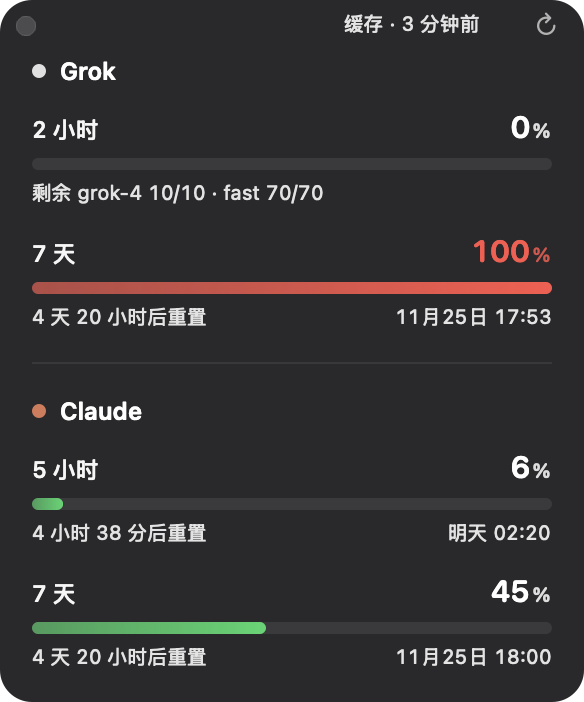

# Quota Glass · 额度

macOS 上的 Liquid Glass 小浮窗，盯着 **Claude** 和 **Grok** 订阅额度：每档一个百分比、一根条、一个重置倒计时。

A tiny native macOS floating panel (Liquid Glass) that shows your Claude and Grok subscription rate limits — session and weekly windows, with reset countdowns.



*截图是 `make preview` 的离屏渲染，背景是实心深灰；实机上是系统的 Liquid Glass。*

## 要求

- macOS 26+（Liquid Glass）；更早的系统自动退回 HUD 磨砂，最低 macOS 13
- Xcode Command Line Tools（`swiftc`）
- 至少一份已登录的凭证，见[凭证](#凭证只读不续期)

## 安装

```bash
git clone https://github.com/guoran-future-hu/quota-glass.git
cd quota-glass
make install      # 编译、装进 ~/Applications/RateLimits.app、启动
make autostart    # 可选：登录自启
```

## 界面

```
●                         缓存 · 2 分钟前  ↻
● Grok
2 小时                                 10%
▬▬▬▬
剩余 grok-4 9/10 · fast 63/70
7 天                                   58%
▬▬▬▬▬▬▬▬▬▬▬▬▬▬▬▬▬▬▬▬▬
4 天 21 小时后重置              11月25日 17:53
─────────────────────────────────────
● Claude
5 小时                                 36%
▬▬▬▬▬▬▬▬▬▬▬▬▬
9 分钟后重置                       今天 21:00
```

- 背景是 Liquid Glass（`NSGlassEffectView`，不加 tint、底色跟系统一致，灰字因此提到 64%/80% 不透明）。内容铺进标题栏：左边只有红点，右边「多久之前 ↻」，刷新时 ↻ 换成转圈。
- 每档三层：「窗口类型 ··· 百分比」→ 全宽 6pt 胶囊条 →「倒计时 ··· 绝对时刻」。窗口类型用中文词（`2 小时` / `5 小时` / `7 天` / `本月`，定义在 `Span`），不用 `2h` `7d`——四个缩写堆一列容易看串。模型级周额度（Opus / Fable）在窗口类型后面多一个淡色模型名。
- 颜色随用量走：<70% 绿、<90% 黄、≥90% 红；≥70% 时百分比数字也跟着变色。
- 提供商名前一个品牌色圆点。整张卡读失败时，名字下面一块淡红底的错误说明；沿用上一轮的数时右上角写「沿用上次」，条形变暗。
- Grok 2 小时窗接口不给重置时刻，第二行写各模型剩余次数。没有数的档写原因的第一句（如「Safari 没开」），完整原因在 tooltip。
- 倒计时和「多久之前」每分钟走一格，不等下一轮取数。

宽度固定 292，高度由内容决定，没有滚动条。位置按**上沿**记（`panelX` / `panelTop`），内容变高变矮时上沿不跳；第一次启动贴屏幕右上角。

## 操作

| 操作 | 结果 |
|---|---|
| **⌥⌘R**（全局热键） | 显示并聚焦 / 再按收起 |
| 左键菜单栏仪表盘图标 | 面板叫到最前并把焦点给它（此时 ⌘W 才有效） |
| 右键 / ⌃-左键 图标 | 菜单：显示面板 · 刷新 · 退出 |
| 直接点面板本身 | 不激活 app、不抢焦点——你在别的窗口打字不会被打断 |
| ⌘W / 红点 | 收起，**进程不退**，仍在后台 5 分钟一刷 |
| ⌘Q | 退出 |
| 收起后 `open -a RateLimits` | 叫回来 |

窗口是 `nonactivatingPanel`：从别处点它不进前台；只有从菜单栏图标 / 热键进来才 `NSApp.activate()`。红点走 `windowShouldClose` → `orderOut` 并返回 `false`，窗口不销毁。

accessory app 没有 Dock 图标，也不自带主菜单，所以 额度 / 文件 两栏是代码里手搭的——⌘W、⌘H、⌘Q 都从这套菜单来。没有黄点绿点（也没有 ⌘M）：没有 Dock 图标，最小化没处去；高度跟内容走，放大没意义。

**刘海屏**：菜单栏图标多了会被排到刘海底下，物理上看不见，macOS 也不会挪。这时靠 ⌥⌘R，或用 Ice / Bartender 之类整理菜单栏。

## 两档分别是什么

| | session | 周 |
|---|---|---|
| Claude | `five_hour`，滚动 5 小时，即订阅里的 session limit | `seven_day`，全模型 7 天。接口若还带 Opus / Sonnet / Fable 的单独周额度，各多一行 |
| Grok | 短窗，`windowSizeSeconds: 7200`（2 小时），按模型计**请求次数** | Settings → Usage 那个共享周池，跨 Chat / Build / Imagine / Voice / API |

百分比没出现在响应里时显示「—」，不当作 0。

## Grok 2 小时窗：只认浏览器会话

`POST grok.com/rest/rate-limits` 用 OAuth 打会 403 `oauth2-auth-forbidden`；CLI 代理也没有对应端点。所以只有两种走法：

**默认：借 Safari 的登录态。** 每轮刷新用 `osascript` 在 grok.com 标签页里发一次同源请求，取完就完，不落 cookie。前提：Safari 开着、有 grok.com 标签页、给过「自动化」授权（首次会弹「RateLimits 想要控制 Safari」，点允许）。

默认探测 `grok-4` 和 `fast`（`grok-4.7` 在这个接口上是 404），条形取两者中用得多的那个。换模型：`GROK_RATE_LIMIT_MODEL=grok-4,fast`。

**备选：cookie 文件。** 不想依赖 Safari 就把 `sso=…`（或整段 `Cookie:` 值）写成一行放进：

```
~/Library/Application Support/RateLimits/grok.cookie
```

权限设 `600`；程序不创建它。有它就直接 HTTP，不碰 Safari。

接口不给重置时刻，只有窗口长度——所以不编一个倒计时，第二行写剩余次数。

## 凭证：只读，不续期

每次刷新重新读文件，用里面当前的 access token。**不调用 refresh、不写回任何凭证文件。** xAI 每次刷新会轮转 refresh token；Claude 的 refresh token 是一次性的——自己去续会把正在用这份凭证的客户端踢下线。

| 谁 | 读哪里（按顺序） | 发给谁 |
|---|---|---|
| Grok | [Hermes](https://github.com/NousResearch/hermes-agent) 的 `~/.hermes/auth.json`（`providers.xai-oauth` 或 `credential_pool.xai-oauth[]`），否则 `grok login` 的 `~/.grok/auth.json` | 周池：`cli-chat-proxy.grok.com/v1/billing?format=credits`，缺百分比再试 `grok.com/.../GetGrokCreditsConfig`（gRPC-web） |
| Claude | Hermes 的 `~/.hermes/.anthropic_oauth.json`，否则 Claude Code 的 `~/.claude/.credentials.json`；未过期的优先 | `GET api.anthropic.com/api/oauth/usage`，头 `anthropic-beta: oauth-2025-04-20` |

不读钥匙串。Claude Code 若只把凭证放在钥匙串、JSON 是空的，面板会写「没有 Claude OAuth」，而不是去弹钥匙串授权。access token 过期时跳过请求，等持有它的客户端自己续完，下一轮重读就好。

## 轮询与缓存

5 分钟一次，点 ↻ 立刻刷新；两家并行取。Claude 的 usage 接口限流很凶，429 时沿用上一次的数（卡片标「沿用上次」，顶栏写「缓存 · 多久之前」）。缓存（不含 token）在 `~/Library/Caches/mac-rate-limits/usage.json`。

## 开发

原生 AppKit，`swiftc` 直接编 `Sources/*.swift`，没有 SwiftPM、没有 webview、没有本地服务。

| 文件 | 管什么 |
|---|---|
| `Model.swift` | `Reading` / `Card` / `Snapshot`、`Span`、`Failure` |
| `Credentials.swift` | 读 token 和 `grok.cookie`（只读） |
| `Grok.swift` / `Claude.swift` | 各家取数和解析，各出一张 `Card` |
| `Protobuf.swift` | Grok gRPC 响应的最小 protobuf 解码 |
| `Snapshot.swift` | 并行取两家、失败时沿用上一轮、缓存 |
| `HTTP.swift` / `Parse.swift` / `Format.swift` | 同步请求、JSON/日期小工具、中文时间格式 |
| `Views.swift` | `Theme` 和所有视图——纯函数，数据进 NSView 出 |
| `Panel.swift` | 浮窗本身：玻璃、尺寸、位置、刷新、渲染 |
| `App.swift` | 菜单栏图标、⌥⌘R 热键、主菜单 |

```bash
make            # 编到 build/RateLimits
make preview    # 用缓存离屏渲染真实面板到 build/preview.png，不取数、不开窗
make json       # 取一次数，打 JSON
make install    # 装进 ~/Applications/RateLimits.app 并重启
make autostart  # 写 ~/Library/LaunchAgents/ai.local.ratelimits.plist，下次登录生效
```

改 UI 先 `make preview` 看图，满意再 `make install`。玻璃画不进离屏位图，preview 用实心深灰代替。ad-hoc 签名每次重签 cdhash 都变，macOS 可能重新弹一次「允许控制 Safari」。

**踩过的坑**（`Views.swift` 的 `split()` / `percentLabels()` 注释里也有）：横排里别放空白 `NSView` 当弹簧——它没有基线，`firstBaseline` 对齐会乱；混字号的 attributed `NSTextField` 在 NSStackView 里不认 hugging，会被拉宽，所以「43」和「%」是两个标签。

想在当前登录里就挂上自启：

```bash
launchctl bootstrap gui/$(id -u) ~/Library/LaunchAgents/ai.local.ratelimits.plist
```

撤掉：

```bash
launchctl bootout gui/$(id -u)/ai.local.ratelimits
rm ~/Library/LaunchAgents/ai.local.ratelimits.plist
```

## License

MIT
